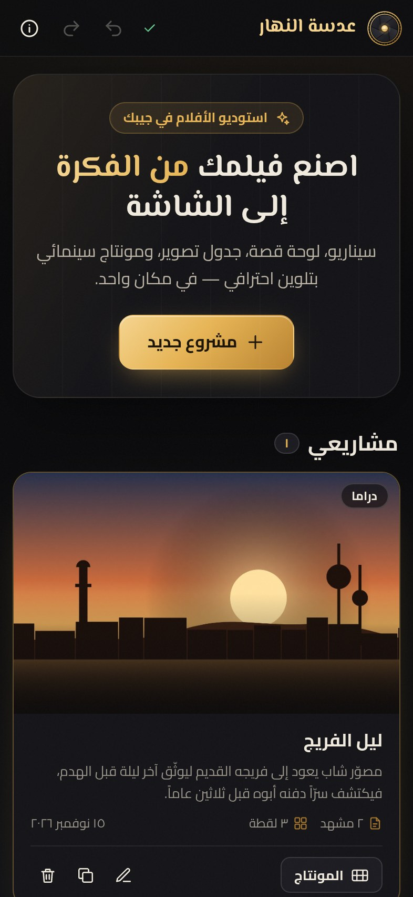
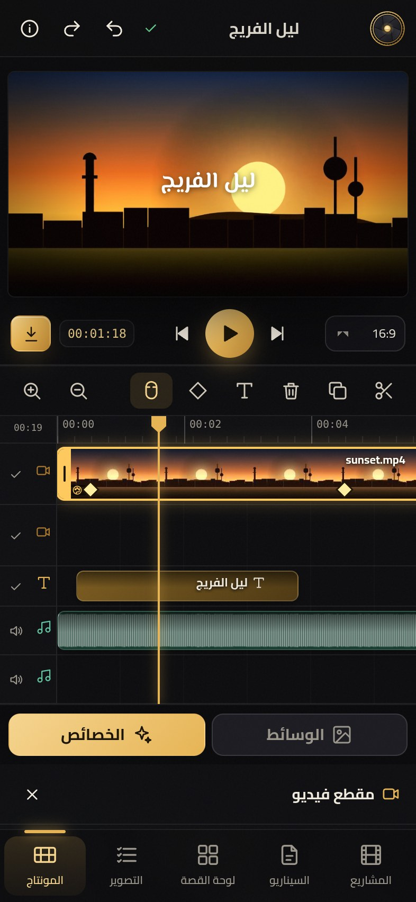
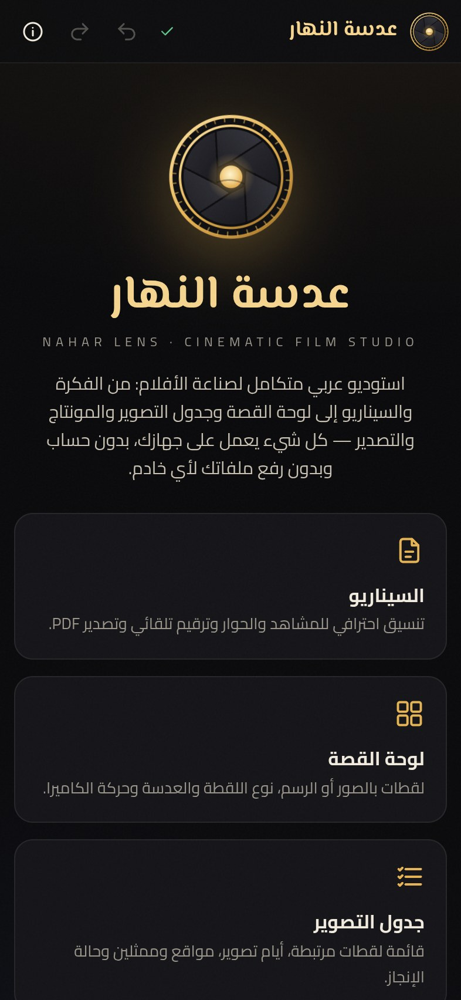
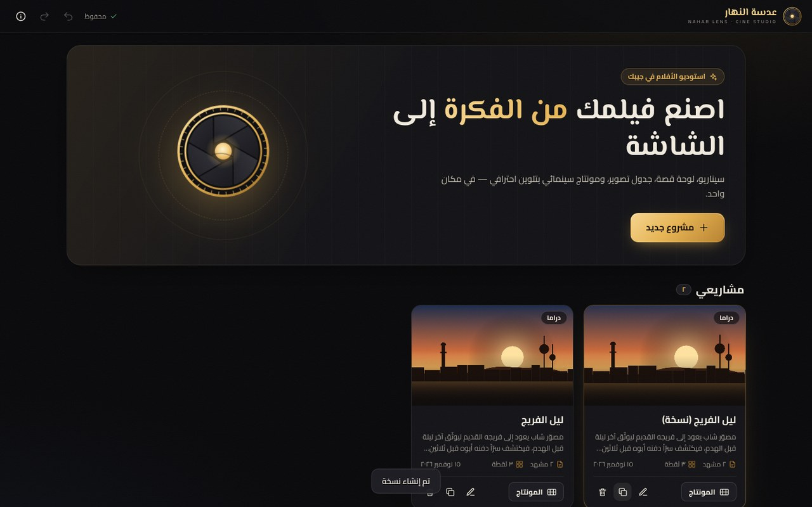

# عدسة النهار — Nahar Lens · Cinematic Film Studio

استوديو عربي متكامل لصناعة الأفلام يعمل في المتصفح كتطبيق ويب تقدمي (PWA): على آيفون، وأجهزة هواوي بدون خدمات جوجل، والكمبيوتر.
لا يحتاج إلى خادم خاص ولا خطوة بناء، ولا يعتمد على أي خدمة من جوجل. كل الملفات والمشاريع تبقى على جهاز المستخدم (IndexedDB).

**مباشر:** https://lens.clipkat.live/  
(نسخة GitHub Pages: https://ahmadalfayed.github.io/nahar-lens/)

**المستودع:** https://github.com/Ahmadalfayed/nahar-lens

## لقطات من التطبيق

<p align="center">
  
  
  
</p>

<p align="center">
  
</p>

## الوحدات
1. **المشاريع**: إنشاء وفتح ونسخ وحذف المشاريع، مع بوستر وتصنيف وفكرة في سطر (Logline).
2. **السيناريو**: أنواع السطور (مشهد، وصف، شخصية، توجيه، حوار، انتقال)، ترقيم تلقائي للمشاهد، إحصاءات، وتصدير PDF عبر الطباعة أو نص عادي.
3. **لوحة القصة**: بطاقات لقطات مع صورة أو رسم بالإصبع أو القلم، وحجم اللقطة والعدسة وحركة الكاميرا والمدة والملاحظات، وإعادة ترتيب بالسحب، و«أنيماتك» ينقل اللقطات إلى المونتاج.
4. **جدول التصوير**: قائمة لقطات مرتبطة تلقائياً بلوحة القصة، وأيام تصوير، ومواقع، وممثلون، وحالة الإنجاز، وطباعة ورقة التصوير.
5. **المونتاج**: خط زمني متعدد المسارات (فيديو ×2، نصوص، صوت ×2) يتضمن:
   - القص والتشذيب والتحريك والمغناطيس والقص المتموج.
   - الانتقالات: مزج متقاطع، تلاشٍ، مسح، انزلاق، تكبير.
   - مفاتيح الحركة: الموضع والحجم والشفافية والدوران.
   - تأثير كين بيرنز، ومنحنيات السرعة (Speed Ramps).
   - تلوين سينمائي عبر WebGL: ١١ قالباً، بالإضافة إلى التعريض والتباين والتشبع والحرارة والصبغة والبهتان والإطار المظلم والحبيبات.
   - العناوين المتحركة، وشريط الاسم، والترجمة، وشارة النهاية.
   - نسب العرض: 16:9، و2.39:1 سينما سكوب، و9:16، و1:1، و4:5.
6. **التصدير**: من 480p إلى 1080p، بمعدل 24 أو 25 أو 30 أو 60 إطاراً في الثانية، وبصيغة MP4 (H.264) إذا دعمها المتصفح وإلا WebM، مع شريط تقدّم.

## التشغيل

افتح النسخة المباشرة: https://ahmadalfayed.github.io/nahar-lens/

أو شغّل المجلد محلياً بأي خادم ملفات ثابتة، مثل:
```
python3 -m http.server 8080
```
ثم افتح `http://localhost:8080`. للتثبيت على الجوال: افتح الرابط من متصفح الجوال (HTTPS)، ثم اختر «إضافة إلى الشاشة الرئيسية».

## اختصارات المونتاج
مسافة: تشغيل · S: قص · Delete: حذف · D: تكرار · K: مفتاح حركة · N: المغناطيس · ←/→: إطار · Shift+←/→: ثانية · Ctrl+Z / Ctrl+Shift+Z: تراجع وإعادة · Ctrl+S: حفظ.

---
جميع الحقوق محفوظة © 2026 وطن النهار — All rights reserved © 2026 Watan Al-Nahar. راجع ملف LICENSE.


## الإعلانات
الإعلانات مطفية افتراضياً. لا تُحمَّل AdSense ولا AdMob ما دامت الأرقام في `js/ads-config.js` فارغة. التفاصيل وخطوات التفعيل لاحقاً (بما في ذلك ads.txt وAdMob وأجهزة هواوي) في [docs/ads.md](docs/ads.md).

## التطبيق الأصلي (Google Play / App Store)
مشروع Capacitor في مجلد `native/` — التفاصيل وخطوات البناء والرفع في [native/README-native.md](native/README-native.md). سياسة الخصوصية: [privacy.html](privacy.html) · https://lens.clipkat.live/privacy.html
